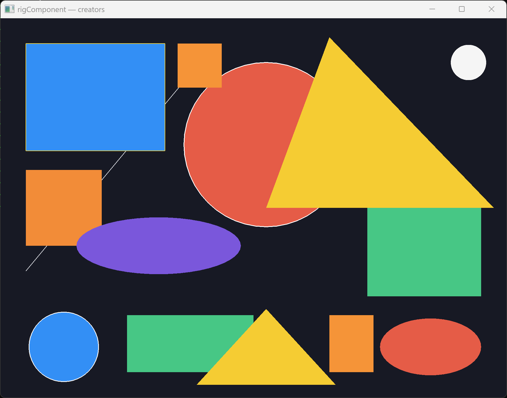

# rigComponent



**Data-only** ECS pack for RigKit

Headers live under `src/` (`C*.h`).

## Build Example

```bash
cmake -S examples/creators -B examples/creators/build
cmake --build examples/creators/build --target creators
```

**Bootstrap order**: register `rigComponent` before `rigSystems` / `UI packs`.

## Style

Format first-party `src/` and `examples/` with clang-format before commit (never `third_party/`).

```bash
./tools/format.sh
./tools/install-hooks.sh    # once per clone - pre-commit formats staged C/C++
```

Hooks only look for `clang-format` on PATH and warn, without formatting, when it is missing. Put it on PATH:

- **Windows:** install [LLVM](https://github.com/llvm/llvm-project/releases) (enable "Add LLVM to the system PATH"), or `winget install LLVM.LLVM`, then open a new shell. Confirm: `clang-format --version`.
- **macOS:** `brew install clang-format`
- **Linux:** `sudo apt install clang-format`

From a RigKit host checkout, `./tools/install-hooks.sh` wires every pack repo. Full policy: [RigKit packs Style](https://github.com/rigkid/RigKit/blob/main/packs/README.md#style).

[API/docs](https://rigkid.github.io/rigComponent/)
