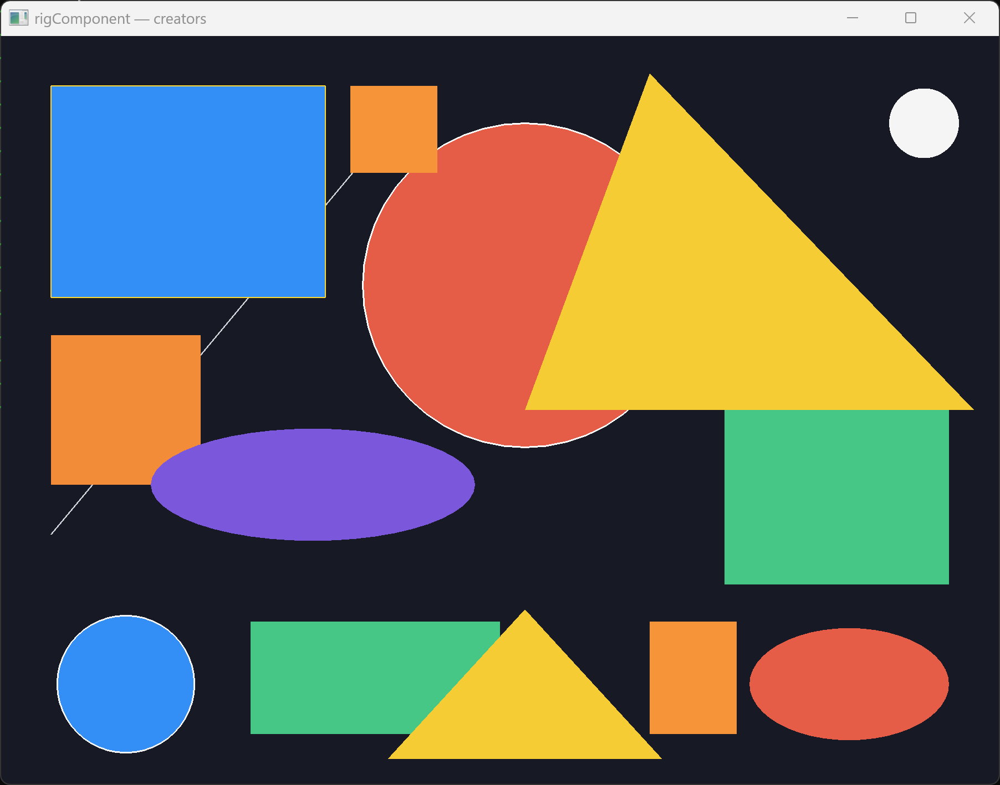

# creators



Hero for **rigComponent** — POD `makeRect` / `makeCircle` / `makeEllipse` / `makeLine` / `makeMesh*` + selection. Present needs `rigSystems` (data pack stays systems-free).

```bash
cmake -S . -B build
cmake --build build --target creators
./build/bin/creators/creators
```

Set `RIGKIT_DIR` if the host is not four levels above this folder.
