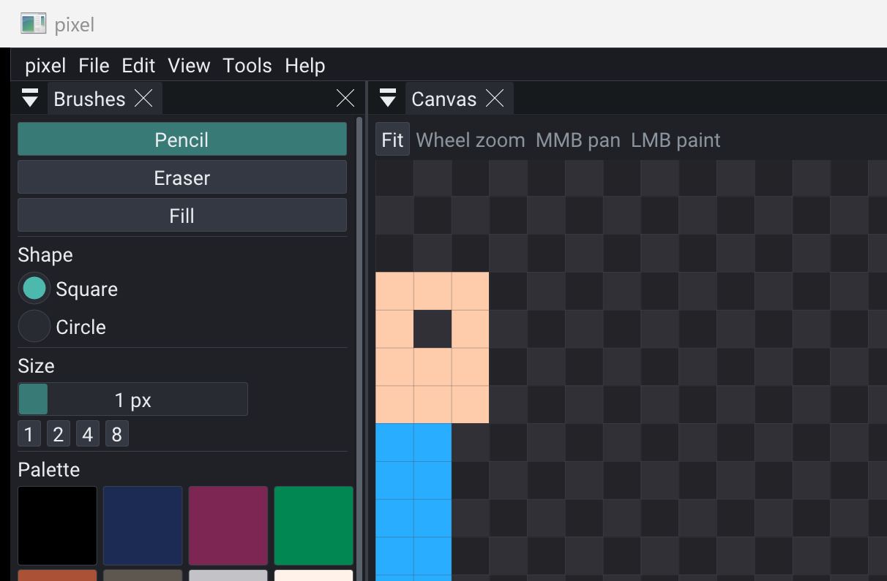

# pixel



Indexed sprite-sheet editor on **rigComponent** PODs: `CIndexedAtlas` + `CPalette` + `CLayer`, plus **rigProject** + **rigImGui**. Pack README screenshot stays on [`../creators`](../creators).

File **New** asks frame size and sheet columns/rows (max 256x256). Paint on the selected unlocked layer. Index 0 is transparent. **Preview** plays the sheet cells. Export the composited sheet as PNG or BMP.

```bash
cmake -S packs/rigComponent/examples/pixel -B packs/rigComponent/examples/pixel/build
cmake --build packs/rigComponent/examples/pixel/build --target pixel
./packs/rigComponent/examples/pixel/build/bin/pixel/pixel
```

| Input | Role |
|-------|------|
| LMB | Pencil / eraser / fill |
| MMB | Pan canvas |
| Wheel | Zoom |
| B / E / G | Pencil / eraser / fill |
| [ ] | Brush size |
| P | Play / pause preview |

Edit menu / Ctrl+Z and Ctrl+Y undo paint strokes, layer add/delete, and property edits. New and Open clear the stack.

Skipped: onion skin, per-frame layer stacks, GL texture upload (ImGui rects; size cap keeps Pi smooth).
